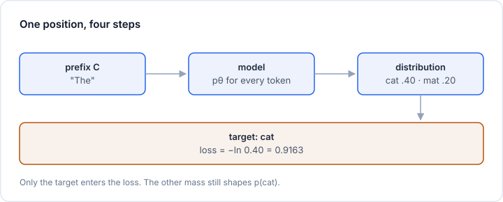

# Cross-Entropy per Prefix

## 1. One prefix, four positions

In a small corpus, the word "The" appears four times. The next word is cat three times and mat once. At its current weights, the model gives cat probability 0.40 after "The", and mat 0.20.

Only the target token enters the loss. The other 0.40 of the model's mass sits on tokens that never follow "The". Those terms carry zero observed frequency, so they add nothing to the sum, but they still lower the probability of cat and mat.

Every position that ends in cat loses

$$
-\ln 0.40 = 0.9163 \ \text{nats}.
$$

Every position that ends in mat loses

$$
-\ln 0.20 = 1.6094 \ \text{nats}.
$$

Average the four positions:

$$
\frac{3(0.9163) + 1(1.6094)}{4} = 1.0896 \ \text{nats}.
$$

That is the loss for the prefix "The": the average surprise at its next token.

## 2. The definition

Let $C$ be the prefix, here "The". Write $q(v)$ for the observed frequency of token $v$ after $C$, and $p(v \mid C)$ for the model's probability.

| symbol | meaning |
|---|---|
| $C$ | the prefix, here "The" |
| $v$ | a token in the vocabulary |
| $q(v)$ | the observed frequency of $v$ after $C$ |
| $p(v \mid C)$ | the model's probability for $v$ after $C$ |

The data gives $q(\text{cat}) = 0.75$ and $q(\text{mat}) = 0.25$. The prefix's cross-entropy, written $H\big(q, p(\cdot \mid C)\big)$, is the average of $-\ln p$ under those frequencies:

$$
H\big(q, p(\cdot \mid C)\big) = -\sum_v q(v) \log p(v \mid C).
$$

Here $\log$ is the natural logarithm, so the unit is nats. The sum runs over the whole vocabulary. A token with $q(v) = 0$ contributes nothing, however much probability the model gives it.

## 3. Two ways to the same number

Average the four positions, or pool the two distinct answers and weight them by count:

$$
-\sum_v q(v)\log p(v \mid C)
= 0.75(0.9163) + 0.25(1.6094)
= 1.0896.
$$

Both routes reach one number. Position by position, the weights are counts. Pooled by answer, the weights are frequencies.

## 4. What the number means

If the model matched the data exactly, $p$ would equal $q$, and the loss would fall to the data's entropy:

$$
H(q) = -0.75\ln 0.75 - 0.25\ln 0.25 = 0.5623.
$$

The current loss is 1.0896. The gap, 0.5272 nats, is the KL divergence between the data and the model at this prefix. Training on the corpus mean NLL pushes each prefix's cross-entropy toward its data entropy.

## 5. A common slip

Do not average the two distinct tokens equally. cat occurs three times and mat once. The unweighted mean is

$$
\frac{0.9163 + 1.6094}{2} = 1.2629,
$$

and that is not this prefix's loss. The weights are counts, not vocabulary size.

## 6. Where the claim ends

A low training loss says the model fits this corpus. It says nothing about text the model has not seen.

> Takeaway: one prefix's loss is the cross-entropy between its observed next-token frequencies and the model's distribution. The corpus loss is a weighted average of those prefix losses.
