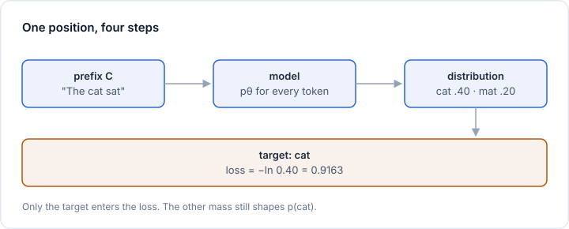
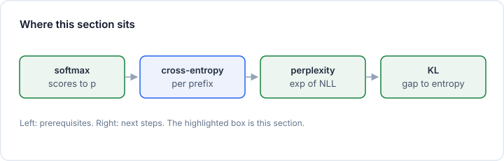

# 讲义原型：同一个概念，七种写法

原文取自 `docs/examples/lecture-12-next-token-rewrite.md` 第 5 节。概念：cross-entropy 按 prefix 计算。深度：`standard`。

判断标准只有一条：读完这一版，你能不能在不回读的情况下，把过程在脑子里走一遍。

七版内容相同，只改表达方式。每版末尾写清它补了什么、没补什么。

---

## 1. 词图相邻

**规则：** 关系用一张图承载，正文只说图里看不出的那一句。

一个位置只罚目标 token 的概率。其余概率质量不加分，但会压低目标的概率。

**补了什么：** 流程和位置关系，一眼可见。
**没补什么：** 为什么用负对数，仍然要靠文字。
**代价：** 每节多一次绘图；图画错时比文字错更难发现。

---

## 2. 先具体后抽象

**规则：** 先走一个带数字的实例，再给定义。

模型看到 "The"，给 cat 0.40，给 mat 0.20。语料里 "The" 后面真的出现了 4 次：cat 三次，mat 一次。目标是 cat，这个位置的损失是

$$
-\ln 0.40 = 0.9163
$$

把 4 个位置平均：

$$
\frac{3(0.9163) + 1(1.6094)}{4} = 1.0896 \ \text{nats}
$$

一个 prefix 的损失，就是目标 token 概率的负对数，按出现次数加权平均。整个语料再把每个 prefix 的损失按它的出现次数汇总。

**补了什么：** 抽象公式出现之前，读者已经有一个能算的例子。
**没补什么：** 关系的全貌，仍要靠读者自己拼。
**代价：** 开头多三行；抽象概念（比如"熵"）不容易找到好例子。

---

## 3. 每章一张关系图

**规则：** 章首放一张位置图，再进内容。

你在这里。左边是先修：softmax 把分数变成概率。右边是后续：perplexity 是平均 NLL 的指数，KL 是当前损失和数据熵的差。

**补了什么：** 这个概念在整章里的位置，以及它依赖谁、支撑谁。
**没补什么：** 这一节内部的推导。
**代价：** 图要和正文同步；改章节时容易忘。

---

## 4. 例题效果

**规则：** 每个形式步骤配一个完整走法，再逐步撤掉。

例：prefix "The" 出现 4 次，目标是 cat 三次、mat 一次。

| token | 次数 | $p$ | $-\ln p$ | 加权 |
|---|---|---|---|---|
| cat | 3 | 0.40 | 0.9163 | 2.7489 |
| mat | 1 | 0.20 | 1.6094 | 1.6094 |

平均：

$$
\frac{2.7489 + 1.6094}{4} = 1.0896
$$

换一个 prefix "The keys"，目标是 "are"。模型给 are 0.70。先自己算这一步的损失，再看下一行。

$$
-\ln 0.70 = 0.3567
$$

**补了什么：** 每个形式动作都有一个数字实例跟着，推导不再悬空。
**没补什么：** 图景；它补的是步骤。
**代价：** 讲义变长；`advanced` 学习者会觉得每一步都被扶着走。

---

## 5. 删杂讯、标结构

**规则：** 编号步骤，删掉旁白、脚注和反问。

1. 取一个 prefix。
2. 读出目标 token 的概率 $p$。
3. 取 $-\ln p$。
4. 按出现次数加权平均。

$$
\frac{3(0.9163) + 1(1.6094)}{4} = 1.0896
$$

**补了什么：** 骨架可见，读者知道自己在第几步。
**没补什么：** 任何画面或直觉。
**代价：** 只改结构，不解决"想不出"。

---

## 6. 分段 + 预训练

**规则：** 术语先给表，一次一个动作。

| 术语 | 含义 |
|---|---|
| prefix | 目标 token 左边的全部 token |
| target | 语料里真实出现的下一个 token |
| NLL | $-\ln p(\text{target} \mid \text{prefix})$ |

### 第一步：固定一个 prefix

取 "The"。它在语料里出现 4 次。

### 第二步：读目标概率

目标是 cat 三次，mat 一次。模型给 cat 0.40，给 mat 0.20。

### 第三步：取负对数

cat 的损失是 0.9163，mat 是 1.6094。按次数平均得 1.0896。

**补了什么：** 术语在用到之前先定义；每段只做一个动作。
**没补什么：** 概念之间的关系。
**代价：** 结构变长；简单概念会被切得太碎。

---

## 7. 自我解释

**规则：** 关键步骤后插入一个问题，先答再看。

损失为什么用 $-\ln p$，而不是 $1-p$？

先自己答一句，再看下面。

因为 $-\ln$ 把概率的乘积变成损失的和。两个独立位置的联合概率是 $p_1 p_2$，取负对数后是 $-\ln p_1 - \ln p_2$。$1-p$ 没有这个性质。

**补了什么：** 读者被迫把理由说出来，而不是认出来。
**没补什么：** 图景；它补的是理解深度。
**代价：** 打断阅读节奏；`advanced` 复习时是噪音。

---

## 对照

| 版本 | 补哪一层 | 现有规则覆盖 | 主要成本 |
|---|---|---|---|
| 1 词图相邻 | 一节之内 | 部分：`study` 已有"when an SVG would materially clarify" | 绘图 |
| 2 先具体后抽象 | 概念开头 | 无 | 开头变长 |
| 3 每章关系图 | 章内位置 | 无 | 图与正文同步 |
| 4 例题效果 | 推导步骤 | 部分：示例讲义已有手算 | 变长，advanced 反感 |
| 5 删杂讯、标结构 | 句子层 | 部分：已有"open each paragraph with its claim" | 只改结构 |
| 6 分段 + 预训练 | 阅读节奏 | 部分：已有符号表 | 切碎 |
| 7 自我解释 | 学习活动 | 复述已覆盖 | 打断 |

前三条互补：节内、概念开头、章内位置。第 4、6、7 条与现有规则重叠最多，加进去的边际效果最小。
