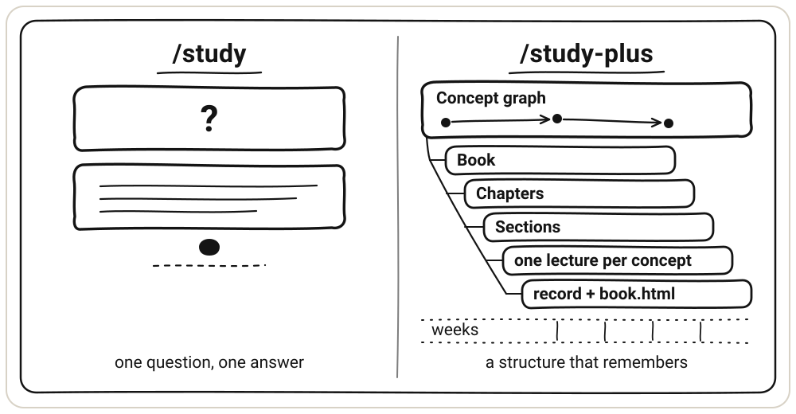
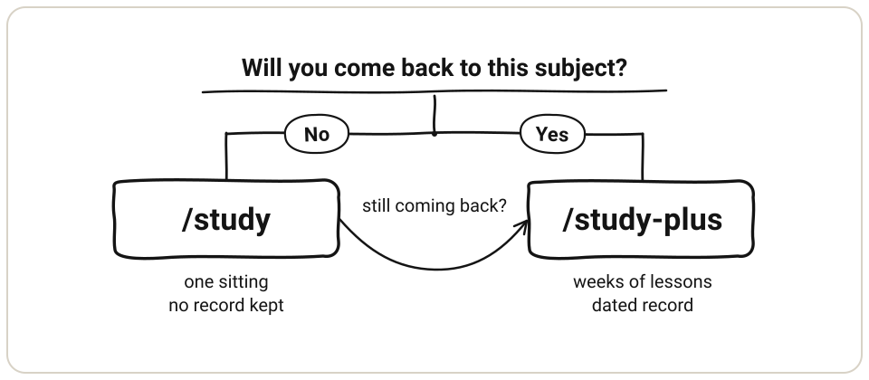

<p align="center">
  
</p>

<h1 align="center">Nerd Mode for DeepSeek Harness</h1>

<hr>

<p align="center"><em>One concept at a time, with a record that outlives the chat.</em></p>

<p align="center">
  <a href="./README.zh.md"></a>
</p>

A chat lesson usually ends when the answer arrives. Nothing checks that you understood it, and nothing survives the tab closing. Nerd Mode makes dsh teach in steps, stop where the choice changes the result, and keep a dated record when a subject deserves one. A topic can then last weeks instead of one sitting.

## Key features

- One switch for the whole conversation. `/nerd-mode on` teaches every learning-shaped request and leaves feature work, searches, and commands alone.
- Two ways to learn. `/study` answers one concept or one task in chat and keeps nothing. `/study-plus` runs one topic over weeks with a dated record.
- A map before the first lesson. A concept graph in prerequisite order, grouped into a Book of Chapters and Sections, approved by you before any file is written.
- One calibration round per topic. It asks your goal, your background, and the concepts you can skip, then sets a teaching level that every lecture follows.
- Teaching that stops at the fork. The guide explains in steps and stops where the choice changes the result, instead of handing over a finished answer.
- Evidence, not impressions. Unseen questions and a graded teach-back, with the rubric written before the question. Only an answer you produced changes the record.
- A record that outlives the chat. The graph, the states, and the dated log survive restarts, and the HTML Book rebuilds after each batch and each lesson, with full-text search.
- Lectures you can find again. The Lectures card lists every saved lecture in the workspace, grouped by topic.

## Requirements

- DeepSeek Harness with a profile.
- Node.js 22.19 or newer.
- Windows, macOS, or Linux.

## Install

From npm:

```powershell
dsh plugin --profile <profile> add dsh-nerd-mode
```

From GitHub:

```powershell
dsh plugin --profile <profile> add github:bocchii-the-code/dsh-nerd-mode
```

From a local folder or tarball:

```powershell
dsh plugin --profile <profile> add C:\path\to\dsh-nerd-mode
```

Restart dsh. Every mode gains the `/nerd-mode` command and a `Nerd Mode` pill in the composer bar. The mode picker gains no new entry, because the plugin mounts at profile level rather than as a preset.

## Usage

Ask a question and Nerd Mode takes one of two paths. Both teach in steps and stop at the fork, the point where the choice changes the result. They differ in what they keep.

<p align="center">
  
</p>

### Quick lesson: `/study`

It walks one concept or one task from the first step to the last and stops once at the fork. A concept comes in layers, from intuition to terms to formal detail. A task comes as the finished artifact, with one line of reason beside each step. It keeps no learner record and grades nothing. It saves a lecture or artifact only when you name a path, and it may draw an SVG figure when a picture helps. The lecture-writing rules that `/study-plus` follows are the ones in this skill.

Use it for a question you want to understand now and will probably not return to.

- Reading a paper and a term stops you.
- A homework problem you have to finish tonight.
- A file whose logic you need to follow before you change it.
- A small decision where you want the trade-off spelled out before you pick.

```text
/study why does Adam divide by 1 - beta^t
/study walk me through the preconditioner in this file        # with code
/study help me finish problem 3, and explain each step        # with homework
```

Type the command, or turn the switch on and just ask. With the switch on, a learning-shaped request gets this shape by default.

An explicit `/study-plus` goes straight to tracked study, even when the request names several concepts. An explicit `/study`, or a request that arrives through Nerd Mode without a command, asks one question when it names two or more independent concepts: a one-off book-style answer in chat, or a tracked `/study-plus` session. The one-off answer uses a title, chapter headings, and section headings in plain Markdown.

You get a title, the central idea, numbered steps, one line of symbols above each formula, and a short table only when four or more symbols keep coming back. Then one worked example, the common mistake, and the single stop at the fork. For a task, you get the finished artifact with its reasoning.

It does not score, keep a learner record, or continue a topic across sessions. A saved lecture or artifact goes only where you ask, at the path you name.

### Long lesson: `/study-plus`

It organizes one topic as a Book of Chapters and Sections, with one concept per Section. It builds a concept graph in prerequisite order, groups the concepts into Chapters, and teaches and assesses one concept in each Concept cycle. The graph carries Chapter and Section columns, so one file records the reading order beside the prerequisite order. It keeps three tracker files and saves one Markdown file per concept under `study/<slug>/lectures/`. Once you approve the graph it prepares a complete draft for every concept, so a lesson starts without waiting. It builds an HTML book from the saved material and refreshes that page whenever the material changes.

Use it for a subject you will still be learning next month.

- You are working through a textbook, a course, or a paper properly.
- You want the textbook's chapters to organize what you reread.
- You want to know what to study next, and a chat only answers what you ask.
- You want evidence of progress, not an impression of it.
- You keep looking things up and forgetting them.

An explicit `/study-plus` starts tracked study directly and does not ask the one-off book question, even when the topic covers several concepts.

```text
/study-plus Shampoo and Adam optimizers              # first session builds the graph
/study-plus                                          # later sessions continue the topic
/study-plus chapter 2                                # read that chapter in Book order
/study-plus the matrix square root                   # jump straight to one concept
```

The first session runs in a fixed order.

```text
/study-plus <topic>
  propose 15 to 30 concepts in prerequisite order, grouped into Chapters
  show the chapter list and the concept table together, then wait
  you approve, edit, or rebuild the graph
  you answer one calibration round: goal, background, and concepts to skip
  write one complete draft per concept, skipped concepts included
  teach each concept: recall (optional) → lecture → configured unseen questions → teach-back → dated record
```

Approval also runs one calibration round: what you want to do with the topic, what you have already read or used, and the concepts you can skip. The answers set `Teaching level` in `graph.md`, beside `Goal` and `Background`, and every lecture follows that level. It shapes the lecture only, never the questions, the teach-back, or the record. A mid-topic change lasts for that session unless you say to keep it.

<p align="center">
  
</p>

Drafts count as preparation, not learning. Every lecture follows the `/study` writing standard and is saved before it is shown.

A concept the graph removes has its lecture file moved to `lectures/archive/`, not deleted.

Later sessions read the tracker files first. You pick a Chapter or a Concept, and it names that Concept, its state, and the state of its prerequisites in one line. Nothing forces a prerequisite order.

Profile defaults live under Settings -> Nerd Mode. They cover whether each tracked session opens with a Recall Session, and how many unseen questions follow a lecture, in which form (short answer, four-option multiple choice, or mixed). Save applies to the next session, Cancel discards a draft, and Restore defaults returns to recall off, 3 questions, short answer. A preference stated inside one `/study-plus` request wins for that session only.

You get a reading order and a prerequisite order, any concept you choose, a graded check for that concept, a saved lecture, and a record that survives restarts. The HTML book refreshes after each draft batch and each lesson, with one page per saved Section in its original order, full text search, and a draft label on unprepared reading.

It schedules no reviews and never guesses that you know something. Only an answer you produced changes the record. An open prerequisite never blocks a concept. It explains or recommends the prerequisite, and the choice stays yours.

### What each one leaves behind

| | `/study`, quick lesson | `/study-plus`, long lesson |
|---|---|---|
| Writes files | saves a lecture or artifact at the path you name, and an SVG when a picture helps | `study/<topic>/`: `graph.md`, `state.md`, `log.md`, one file per concept, `book.html` refreshed automatically |
| Reads files | no reads by default, but reads or writes a requested artifact path | the three tracker files, before the first line |
| Remembered next session | no | yes, with dates |
| Graded | no | each concept, rubric written first |
| Organized as | one concept, one task, or a one-off book | Book, Chapter, Section |
| Typical span | one sitting, one idea | 15 to 30 concepts over weeks |

`/study` does not create a `study/` folder by itself. A saved lecture or artifact goes where you name it, including a path under `study/<topic>/lectures/`. A figure goes to `diagrams/<topic>/` unless you name another path. It must not read or write `graph.md`, `state.md`, `log.md`, or `plan.md`.

### Which one

<p align="center">
  
</p>

- A question you will not return to: `/study`.
- A subject you will return to for weeks: `/study-plus`.
- A textbook whose chapters should shape the reading order: `/study-plus`, which mirrors them as Chapters.
- Started with `/study` and keep coming back? Build the graph once with `/study-plus`, and the earlier conversation still informs it.

One example. You are reading the Shampoo paper and hit the preconditioner. `/study what does the Shampoo preconditioner actually do` settles it in one sitting. If you decide to read the paper properly over a month, open `/study-plus Shampoo and Adam optimizers` and let it order the concepts first.

### Commands

```text
/nerd-mode on           teaching posture for this conversation
/nerd-mode off
/study <concept or task>
/study-plus <topic>     recorded session with the three tracker files
```

The book page is not a command. `/study-plus` refreshes it after each draft batch and each lesson, and keeps the previous copy as `book.html.bak`.

The pill in the composer bar sends `/nerd-mode`. It sits left of Full Throttle, stays visible in both states, and goes dim when off.

## What the switch does

- It changes text, not tools. The tool set and the prompt cache stay stable.
- Teaching applies to learning-shaped requests only: explain a concept, tutor homework, walk through code, prepare for an exam. A feature request, a search, a config edit, or a command runs as usual.
- The switch is per conversation. Its state lives in the session log, so compaction and resume keep it.
- If the command fails, a toast at the top of the window names the reason, and the pill keeps its state.
- Subagents run their own session, so each starts with the switch off.
- It cannot delete a base mode's persona text. It outranks that text by declaration.

## Skills included

- `study`: the no-grading guide and the lecture-writing standard. Saves a requested file and draws figures when useful.
- `study-plus`: the recorded session. Book, Chapters, Sections, one lecture per concept, assessment per concept.
- `diagram`: one SVG figure per idea. Written for this package.
- `answer-me-with-html`: one-page HTML explainers, by QingYunA.
- `teach`: a dated teaching workspace, by Matt Pocock.
- `writing-beats`: beat-by-beat article structure, by Matt Pocock.
- `humanizer`: rewrite AI-sounding prose, by Siqi Chen.
- `convert-documents-to-markdown`: Word, PDF, and ebook conversion, by firecrawl.

## Notes

- The plugin loads its own `skills/` folder from `cordis.patch.yml` with a `!!js` expression. Review patch changes as host-process code.
- If you rename the package, update the `resolve('dsh-nerd-mode/package.json')` string in `cordis.patch.yml`.
- Bundled third-party skills keep their own licenses. See [NOTICE.md](./NOTICE.md).
- Design notes: [SPEC v3](./docs/specs/2026-10-28-study-plus-v3.md), [v2, historical](./docs/specs/2026-10-27-study-plus-v2.md), [session defaults spec](./docs/specs/2026-10-28-nerd-mode-settings.md), [GLOSSARY.md](./GLOSSARY.md), `docs/adr/`. Doc layout: [docs/README.md](./docs/README.md).
- Tested with `@deepseek-ai/dsh` 0.2.1-rc.3 on Node 22.

## Uninstall

```powershell
dsh plugin --profile <profile> remove dsh-nerd-mode
```

## License

MIT. Bundled skills keep their own licenses. See [NOTICE.md](./NOTICE.md).
