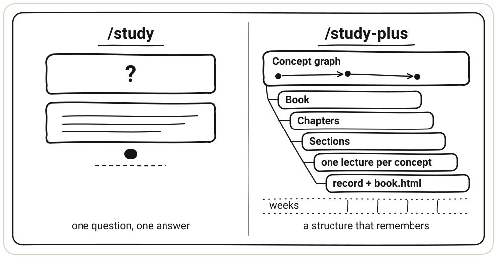
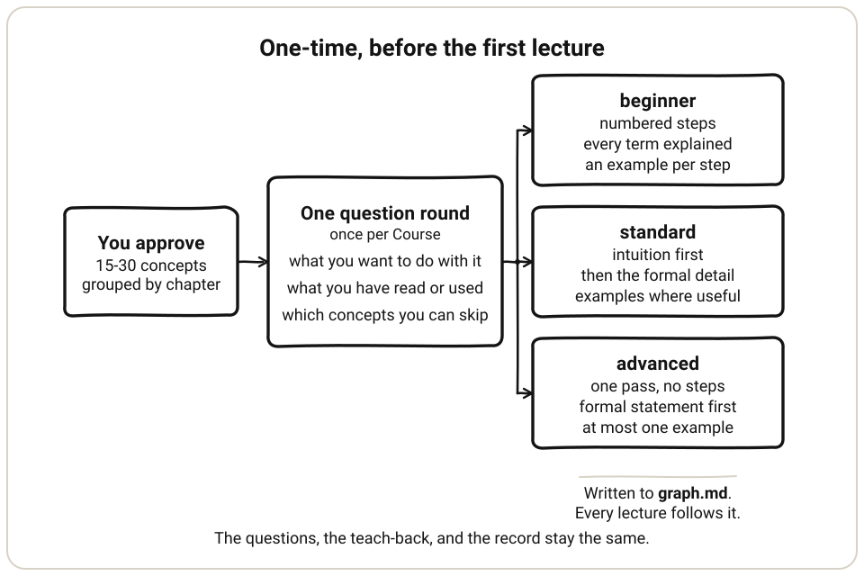
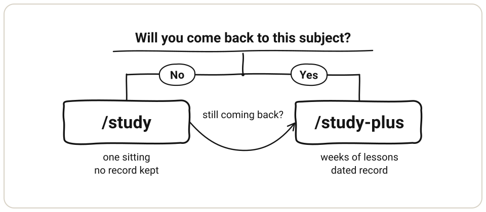

<p align="center">
  
</p>

<h1 align="center">Nerd Mode for DeepSeek Harness</h1>

<hr>

<p align="center"><em>What education should really be like, not just plain lecture notes.</em></p>

<p align="center">
  <a href="https://www.npmjs.com/package/dsh-nerd-mode"></a>
  <a href="https://github.com/bocchii-the-code/dsh-nerd-mode/actions/workflows/check.yml"></a>
  <a href="https://github.com/bocchii-the-code/dsh-nerd-mode/blob/main/LICENSE"></a>
  <a href="./README.zh.md"></a>
</p>

A study switch for DeepSeek Harness that teaches in steps and keeps a dated Course record.

A chat lesson ends when the answer arrives. Nothing checks that you understood it, and nothing survives the tab closing. Nerd Mode makes dsh teach in steps, stop where the choice changes the result, and keep a dated record when a subject deserves one. A Course can last weeks instead of one sitting.

| Command | What it does | What it keeps |
|---|---|---|
| `/nerd-mode on` | turns teaching on for this conversation | nothing; it is a switch |
| `/study` | answers one concept or one task | a file, and only at the path you name |
| `/study-plus` | runs one Course, one concept per session | graph, states, log, lectures, HTML Book |

## Contents

- [Features](#features)
- [Install](#install)
- [Quick start](#quick-start)
- [Two ways to learn](#two-ways-to-learn)
- [Settings](#settings)
- [How it fits into dsh](#how-it-fits-into-dsh)
- [What the switch changes](#what-the-switch-changes)
- [Skills included](#skills-included)
- [Development](#development)
- [Contributing](#contributing)
- [Uninstall](#uninstall)
- [License](#license)

## Features

- **A map before the first lesson.** A concept graph in prerequisite order, grouped into a Book of Chapters and Sections, approved before any file is written.
- **One question round.** Goal, background, and a choice between one answer and a tracked Course. A tracked Course also asks what you can skip.
- **Teaching that stops at the fork.** The guide explains in steps and stops where the choice changes the result, instead of handing over a finished answer.
- **Graded checks.** Unseen questions and a graded teach-back, with the rubric written before the question. Only an answer you produced changes the record.
- **A record that outlives the chat.** Graph, states, and dated log survive restarts, and the HTML Book has full-text search.
- **Progress without opening a file.** The Study tab reads the Tracker for this conversation and shows one progress percentage, the previous, current, and next Section, the shaky Concepts, and the three most recent Concept cycles. It never writes.
- **Lectures you can find again.** The Lectures tab keeps the course picker in the page header, lists only the courses that exist, and marks each lecture as a draft, a dated lecture, or an archived one. The archived lectures fold behind a count.
- **Your study conversations in one place.** The Study Sessions panel in the left sidebar lists every conversation where Nerd Mode was switched on at least once, in three groups: In-depth, Quick, and Past. Each group folds from its heading, In-depth and Quick start open, Past starts closed, and a click opens that conversation.

## Install

Requires DeepSeek Harness with a profile and Node.js 22.19 or newer, on Windows, macOS, or Linux. Tested with `@deepseek-ai/dsh` 0.2.1-rc.3 on Node 22.

From npm:

```powershell
dsh plugin --profile <profile> add dsh-nerd-mode
```

From GitHub:

```powershell
dsh plugin --profile <profile> add github:bocchii-the-code/dsh-nerd-mode
```

From a local folder or tarball:

```powershell
dsh plugin --profile <profile> add C:\path\to\dsh-nerd-mode
```

Restart dsh. Every mode gets the `/nerd-mode` command and a `Nerd Mode` pill in the composer bar. The mode picker shows no new entry, because the plugin mounts at profile level, not as a preset.

## Quick start

1. Add the plugin with one of the commands above, then restart dsh.
2. Turn teaching on for this conversation: `/nerd-mode on`.
3. Ask one question: `/study why does Adam divide by 1 - beta^t`.
4. Keep the subject for weeks: `/study-plus Shampoo and Adam optimizers`.

## Two ways to learn

Both paths teach in steps and stop at the fork, the point where the choice changes the result. They differ in what they keep.

An explicit `/study` goes straight to one-off teaching. An explicit `/study-plus` goes straight to tracked study, even when the request names several concepts. With the switch on and no command, a learning request gets one question round first. It asks for goal and background as single choices, and whether you want one complete answer in this conversation or a tracked `/study-plus` session.

<p align="center">
  
</p>

### Quick lesson: `/study`

`/study` walks one concept or one task from the first step to the last and stops once at the fork. A concept comes in layers: intuition, then terms, then formal detail. A task comes as the finished artifact, with one line of reason beside each step. The guide grades nothing and keeps no learner record.

Use it for a question you want to understand now and will probably not return to.

- Reading a paper and a term stops you.
- A homework problem you have to finish tonight.
- A file whose logic you need to follow before you change it.
- A small decision where you want the trade-off spelled out first.

```text
/study why does Adam divide by 1 - beta^t
/study walk me through the preconditioner in this file        # with code
/study help me finish problem 3, and explain each step        # with homework
```

You get a title, the central idea, numbered steps, one line of symbols above each formula, and a short table when four or more symbols keep coming back. Then one worked example, the common mistake, and the single stop at the fork.

The only files it writes are the ones you ask for: a lecture or artifact at the path you name, and a figure when a picture helps. A figure goes to `diagrams/<name>.svg`, or to `study/<course>/diagrams/` inside a Course. `/study` never reads or writes `graph.md`, `state.md`, `log.md`, or `plan.md`.

### Long lesson: `/study-plus`

A Course is organized as a Book of Chapters and Sections, with one concept per Section. A concept graph in prerequisite order groups the concepts into Chapters. The graph carries Chapter and Section columns, so one file records the reading order beside the prerequisite order.

The Course has three tracker files at its root and one Markdown lecture per concept under `study/<course>/lectures/`. After you approve the graph, the guide prepares a complete draft for every concept, so a lesson starts without waiting. It builds an HTML book from the saved material.

Use it for a subject you will still be learning next month.

- You are working through a textbook, a course, or a paper properly.
- You want the textbook's chapters to organize what you reread.
- You want to know what to study next, and a chat only answers what you ask.
- You want proof of progress you can point to.

```text
/study-plus Shampoo and Adam optimizers              # first session builds the graph
/study-plus                                          # later sessions continue the Course
/study-plus chapter 2                                # read that chapter in Book order
/study-plus the matrix square root                   # jump straight to one concept
```

A Course is one folder under `study/`: one concept graph, one state file, one log, its lectures, its figures, and its Book. A conversation settles its Course on the first tracked study, then asks no more. When the workspace holds one Course, `/study-plus` uses it and names it in one line. Several Courses get one question that lists them and offers a new Course. A request about a second subject gets one question: add these concepts to the current Course, or start a new Course.

#### The first session

```text
/study-plus <course>
  propose 15 to 30 concepts in prerequisite order, grouped into Chapters
  show the chapter list and the concept table together, then wait
  you approve, edit, or rebuild the graph
  you answer one calibration round: goal, background, and concepts to skip
  write one complete draft per concept, skipped concepts included
  teach each concept: recall (optional) → lecture → configured unseen questions → teach-back → dated record
```

Approval also asks the remaining calibration items: what you want to do with the Course, what you have already read or used, and the concepts you can skip. When the opening question already answered your goal and background, it asks only the concepts you can skip. The answers set `Teaching level` in `graph.md`, beside `Goal` and `Background`, and every lecture follows that level.

| Level | Chosen when | Lecture shape |
|---|---|---|
| `beginner` | most prerequisites are unknown | 3 to 7 numbered steps, every term explained, one example per step |
| `standard` | some prerequisites are known | intuition first, then formal detail, examples where they help |
| `advanced` | most prerequisites are known | one pass, no numbered steps, starts from the formal statement, at most one example per idea |

<p align="center">
  
</p>

The level shapes the lecture only, never the questions, the teach-back, or the record. A mid-Course change lasts for that session unless you say to keep it.

Drafts count as preparation, not learning. Every lecture follows the `study` skill's writing standard, and the guide saves the file before showing it. When the graph drops a concept, its lecture file moves to `lectures/archive/` instead of being deleted.

Later sessions read the tracker files first. You pick a Chapter or a Concept, and it names that Concept, its state, and the state of its prerequisites in one line. Nothing forces a prerequisite order. An open prerequisite never blocks a concept: the guide explains or recommends it, and the choice stays yours.

The HTML book refreshes after each draft batch and each lesson, with one page per Section and a draft label where no lecture exists yet. Section numbers come from the graph, so a missing lecture leaves no gap. The previous copy stays as `book.html.bak`. The book page is not a command.

### What each one leaves behind

| | `/study`, quick lesson | `/study-plus`, long lesson |
|---|---|---|
| Writes files | saves a lecture or artifact at the path you name, and an SVG when a picture helps | `study/<course>/`: `graph.md`, `state.md`, `log.md`, one file per concept, `book.html` refreshed automatically |
| Reads files | no reads by default, but reads or writes a requested artifact path | the three tracker files, before the first line |
| Remembered next session | no | yes, with dates |
| Graded | no | each concept, rubric written first |
| Organized as | one concept, one task, or a one-off book | Book, Chapter, Section |
| Typical span | one sitting, one idea | 15 to 30 concepts over weeks |

`/study` does not create a `study/` folder by itself. `/study-plus` schedules no reviews and never guesses that you know something.

### Which one

<p align="center">
  
</p>

- A question you will not return to: `/study`.
- A subject you will return to for weeks: `/study-plus`.
- A textbook whose chapters should shape the reading order: `/study-plus`, which mirrors them as Chapters.
- Started with `/study` and keep coming back? Build the graph once with `/study-plus`, and the earlier conversation still informs it.

### Commands

```text
/nerd-mode on           teaching posture for this conversation
/nerd-mode off
/study <concept or task>
/study-plus <course>    recorded session with the three tracker files
```

The pill in the composer bar sends `/nerd-mode`. It sits left of Full Throttle, stays visible in both states, and goes dim when off.

## Settings

Change the defaults under Settings → Nerd Mode.

| Setting | Choices | Default |
|---|---|---|
| Recall Session | on, off | off |
| Questions after a lecture | 0 to 10 | 3 |
| Question type | short answer, multiple choice, mixed | short answer |

A four-option question appears as a card with one correct choice. The guide asks a short-answer question in the conversation. Save applies to the next session, Cancel discards a draft, and Restore defaults returns to recall off, 3 questions, short answer. A preference stated inside one `/study-plus` request wins for that session only and does not update the profile.

The About group at the bottom shows the installed and the newest npm version. Its button installs an update through DSH Market and offers a restart when the host allows one. The whole page follows the DSH interface language.

## How it fits into dsh

Nerd Mode is a profile-level plugin, mounted from `cordis.patch.yml`. The patch covers the whole profile, so every mode gains the command and the pill.

```text
package.json
├── dsh.bundle.patch → cordis.patch.yml
│     ├── dsh-nerd-mode → lib/index.js
│     │     ├── session projection — on/off state, folded from the session log
│     │     ├── prompt section — assets/section.md at order 550, while on
│     │     ├── /nerd-mode — the switch
│     │     └── GET /api/study-sessions — the read-only session index
│     ├── study-plus-skills — skills/ as a filesystem skill provider
│     └── goal packages — disabled
└── dsh.client → client.js: pill, Study tab, Lectures tab, Study Sessions panel, Settings section
```

**State** lives in a session projection. It folds from the session log, so compaction, resume, and fork keep it. The prompt section has text only while that state is on.

**Prompt text** is `assets/section.md`, the only prompt text the plugin adds, so a profile patch never carries a stale copy. A `section` config value replaces it.

**Settings** reach the model as a short defaults block appended to that section, only during a tracked session. They never change the tool set.

**Session history** is a second, read-only store. `lib/study-sessions.js` scans the conversation logs in chunks, keys each file by its size and modification time, and writes `~/.dsh/study-sessions-index.json`, which sits outside every workspace. The panel reads it through one route that answers only GET, refuses a request with no session cookie (401) and a foreign host or origin (403).

**Patch scope** covers the whole profile. It loads `skills/` with a `!!js` expression, so review patch changes as host-process code. It also disables the three goal packages, because the built-in goal tool turns one study answer into an auto-continuing run.

## What the switch changes

- It changes text, not tools, and applies to this conversation only. The tool set and the prompt cache stay stable, and compaction or resume keeps its state.
- Teaching applies to learning-shaped requests only: explain a concept, tutor homework, walk through code, prepare for an exam. A feature request, a search, a config edit, or a command runs as usual.
- If the command fails, a toast at the top of the window names the reason, and the pill keeps its state.
- Subagents run their own session, so each starts with the switch off.
- It cannot delete a base mode's persona text, but it outranks that text by declaration.

## Skills included

### Teaching

- `study`: the no-grading guide and the lecture-writing standard. Saves a requested file and draws figures when useful.
- `study-plus`: the recorded session. Book, Chapters, Sections, one lecture per concept, assessment per concept.
- `diagram`: one SVG figure per idea. Written for this package.

### General tools

These four ship with the package but sit outside the teaching flow. None of them reads or writes a Tracker.

- `answer-me-with-html`: one-page HTML explainers, by QingYunA.
- `writing-beats`: beat-by-beat article structure, by Matt Pocock.
- `humanizer`: rewrite AI-sounding prose, by Siqi Chen.
- `convert-documents-to-markdown`: Word, PDF, and ebook conversion, by firecrawl.

## Development

```powershell
git clone https://github.com/bocchii-the-code/dsh-nerd-mode
cd dsh-nerd-mode
npm install
npm run check
```

`npm run check` runs ESLint and the Node test suite. `npm test` runs the tests alone, and `npm run lint` runs ESLint alone.

| Path | Holds |
|---|---|
| `lib/index.js` | plugin entry: projection, prompt section, command, session defaults, session index route |
| `lib/fold.js` | the state fold and its constants |
| `lib/study-sessions.js` | the session history scan and its index |
| `client.js` | composer pill, Study and Lectures tabs, Study Sessions panel, Settings section |
| `assets/section.md` | the teaching policy prompt |
| `skills/` | bundled skills |
| `test/` | one file per surface, run by `node --test` |

To try a local build, add this folder as a plugin: `dsh plugin --profile <profile> add .`

If you rename the package, update the `resolve('dsh-nerd-mode/package.json')` string in `cordis.patch.yml`.

Design notes: [SPEC v3](./docs/specs/2026-10-28-study-plus-v3.md), [v2, historical](./docs/specs/2026-10-27-study-plus-v2.md), [session defaults spec](./docs/specs/2026-10-28-nerd-mode-settings.md), [GLOSSARY.md](./GLOSSARY.md), `docs/adr/`. Doc layout: [docs/README.md](./docs/README.md). Version history: [CHANGELOG.md](https://github.com/bocchii-the-code/dsh-nerd-mode/blob/main/CHANGELOG.md).

## Contributing

Issues and pull requests are welcome on [GitHub](https://github.com/bocchii-the-code/dsh-nerd-mode/issues). Run `npm run check` before you open a pull request. For a change to the teaching prompt, read `docs/adr/` first, because the prompt behavior is recorded there.

## Uninstall

```powershell
dsh plugin --profile <profile> remove dsh-nerd-mode
```

## License

MIT. Bundled skills keep their own licenses. See [NOTICE.md](./NOTICE.md).
