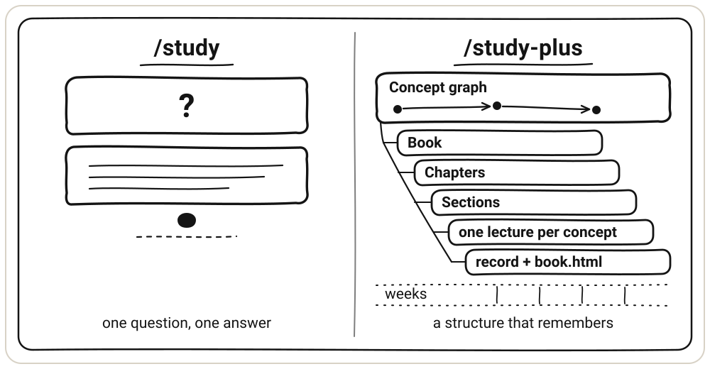
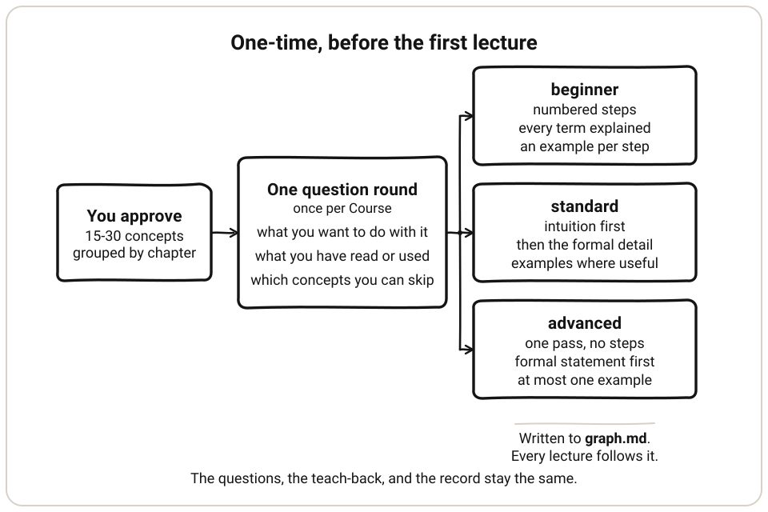
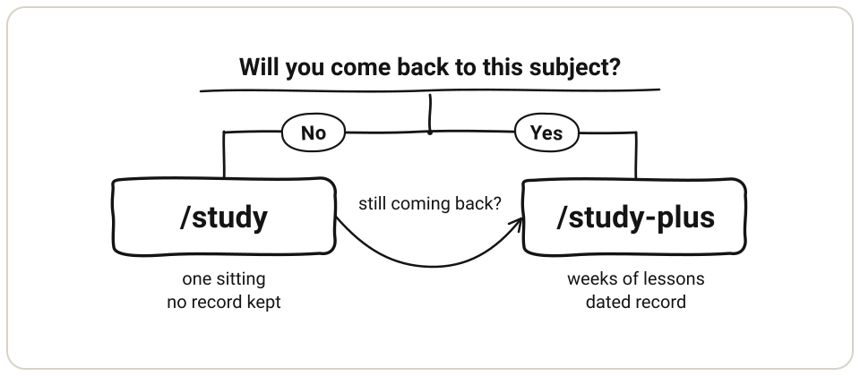

<p align="center">
  
</p>

<h1 align="center">Nerd Mode：dsh 学习开关</h1>

<hr>

<p align="center"><em>教育本该如此，而不只是干巴巴的讲义。</em></p>

<p align="center">
  <a href="https://www.npmjs.com/package/dsh-nerd-mode"></a>
  <a href="https://github.com/bocchii-the-code/dsh-nerd-mode/actions/workflows/check.yml"></a>
  <a href="https://github.com/bocchii-the-code/dsh-nerd-mode/blob/main/LICENSE"></a>
  <a href="./README.md"></a>
</p>

一个 DeepSeek Harness 学习开关：分步教学，并为每个 Course 留下带日期的记录。

聊天里的学习通常在答案到达时就结束了。没人检验你有没有弄懂，关掉窗口也什么都不剩。Nerd Mode 让 dsh 一步步地教，在换个选择就会改变结果的地方停下来，遇到值得跟的科目就留下带日期的记录。一个 Course 能撑过几周，而不只是一次对话。

| 命令 | 做什么 | 留下什么 |
|---|---|---|
| `/nerd-mode on` | 这次对话进入教学状态 | 不留；它只是一个开关 |
| `/study` | 讲一个概念，或做一件事 | 只有你指定路径时才存文件 |
| `/study-plus` | 跑一个 Course，每次一个概念 | 概念图、状态、日志、讲义、HTML 书 |

## 目录

- [主要功能](#主要功能)
- [安装](#安装)
- [快速开始](#快速开始)
- [两条学习路径](#两条学习路径)
- [设置](#设置)
- [它怎么接进 dsh](#它怎么接进-dsh)
- [开关改了什么](#开关改了什么)
- [内置技能](#内置技能)
- [开发](#开发)
- [贡献](#贡献)
- [卸载](#卸载)
- [许可](#许可)

## 主要功能

- **先有图，再上课。** 概念按先修顺序排好，分进 Book、Chapter、Section，等你批准之后才写文件。
- **开课前只问一轮。** 目标、背景，以及在对话里一次讲完还是建一份跟下去的记录。走记录时再问哪些概念可以跳过。
- **讲到分叉点就停。** 讲义一步一步地讲，在换个选择就会改变结果的地方停下来问你，不会直接把成品答案端上来。
- **有评分的检查。** 没见过的题加上要评分的复述，评分标准在出题之前就写好。只有你自己答出来的内容才会改写记录。
- **记录比对话活得久。** 概念图、状态和带日期的日志能跨重启保留，HTML 书支持全文搜索。
- **不用翻文件就能看进度。** Study 标签页读当前对话的记录文件，显示进度百分比，上一节、当前节、下一节三格，状态是 shaky 的概念，以及最近三轮概念循环。它只读，不写。
- **讲义找得回来。** Lectures 标签页把课程下拉放在页头，只列出真实存在的 Course，并把每份讲义标成草稿、带日期或已归档。已归档的讲义收在一个折叠区里，标题旁显示数量。
- **学习会话都在一处。** 左侧边栏的 Study Sessions 面板列出所有至少打开过一次 Nerd Mode 的会话，分「深入」「快速」「过去」三组。每组都能点标题折叠，深入和快速默认展开，过去默认收起，点一行就打开那个会话。

## 安装

需要装有 profile 的 DeepSeek Harness、Node.js 22.19 或更新，Windows、macOS 或 Linux 均可。在 `@deepseek-ai/dsh` 0.2.1-rc.3 和 Node 22 上测过。

从 npm：

```powershell
dsh plugin --profile <profile> add dsh-nerd-mode
```

从 GitHub：

```powershell
dsh plugin --profile <profile> add github:bocchii-the-code/dsh-nerd-mode
```

从本地目录或压缩包：

```powershell
dsh plugin --profile <profile> add C:\path\to\dsh-nerd-mode
```

重启 dsh。每个模式都会多出 `/nerd-mode` 命令，输入框工具栏多一个 `Nerd Mode` 胶囊。模式选择器里看不到新条目，因为插件挂在 profile 层，不是预设。

## 快速开始

1. 用上面的任一命令装好插件，然后重启 dsh。
2. 让这次对话进入教学状态：`/nerd-mode on`。
3. 问一个问题：`/study 为什么 Adam 要除以 1 - β^t`。
4. 想把科目跟下去：`/study-plus 洗发水与 Adam 优化器`。

## 两条学习路径

两条都分步骤讲，都会在分叉点停下来问一次。区别在于它们留下什么。

显式输入 `/study` 会直接在对话里讲。显式输入 `/study-plus` 会直接进入带记录的会话，即使请求里有多个概念。打开开关、没敲命令直接提问时，学习类请求会先问一轮。它问目标、背景各选一项，以及在对话里一次讲完还是走带记录的 `/study-plus`。

<p align="center">
  
</p>

### 快速课程：`/study`

它把一个概念或一个任务从第一步走到最后一步，只在分叉点停一次。概念按层次讲：先直觉，再术语，最后形式细节。任务直接产出成品，每一步旁边写一行理由。全程不打分，也不保存学习者记录。

适合现在就想弄懂、之后大概不会再回来的问题。

- 读论文卡在一个术语上。
- 今晚必须交的一道作业。
- 改代码之前，要先把这段逻辑理顺。
- 一个不大的选择，想先看清取舍再决定。

```text
/study 为什么 Adam 要除以 1 - β^t
/study 帮我把这个文件里的预条件子讲清楚          # 带代码
/study 帮我把第三题做完，每一步都说原因          # 带作业
```

你会拿到：标题、中心思想、编号步骤，每个公式上方一行符号说明。四个以上符号在多个公式里反复出现时，开头再加一张速查表。然后是一个具体例子、常见错误，以及在分叉点停的那一次。

它只写你要的东西：你指定路径的讲义或成品，以及需要配图时的一张图。图放在 `diagrams/<name>.svg`；在 Course 里，图放在 `study/<course>/diagrams/<name>.svg`。它不得读写 `graph.md`、`state.md`、`log.md` 或 `plan.md`。

### 长课程：`/study-plus`

一个 Course 组织成一本 Book，下面分 Chapter，每个 Chapter 下分 Section，每个 Section 只放一个概念。先按先修顺序建概念图，再把概念分进各章。概念图里同时带 Chapter 和 Section 两列，所以一张图里既有阅读顺序，也有先修顺序。

这个 Course 的根目录下有三个记录文件。每个概念保存一份 Markdown 讲义，放在 `study/<course>/lectures/`。你批准概念图后，它会为每个概念先写好一份完整讲稿，开讲不用等准备。它用已保存的材料生成一个 HTML 书页。

适合下个月你还在学的东西。

- 认真读一本教材、一门课或一篇论文。
- 想让教材的章节目录成为之后复习的骨架。
- 需要知道下一步该学什么，而不只是现在该问什么。
- 想要能拿出证据的进度。

```text
/study-plus 洗发水与 Adam 优化器          # 第一次建图
/study-plus                               # 之后继续同一个 Course
/study-plus 第 2 章                       # 按书中顺序读这一章
/study-plus 矩阵平方根                    # 直接跳到某个概念
```

一个 Course 就是 `study/` 下的一个文件夹，里面有一份概念图、一个状态文件、一份日志，外加讲义、图和 Book。一次对话在第一次带记录的讲解时定下 Course，之后不再问。工作区里只有一个 Course 时，`/study-plus` 直接用它，在一行里说明，不问。有多个 Course 时，用一个问题列出它们，并给出新建 Course 的选项。问到另一个科目时，只问一次：把这些概念加进当前 Course，还是新建一个 Course。

#### 第一次会话

```text
/study-plus <course>
  按先修顺序给出 15 到 30 个概念，分进各章
  章节列表和概念表一起给你看，然后等你确认
  你批准、修改或重建概念图
  你回答一轮开课校准：目标、背景，以及哪些概念可以跳过
  为每个概念写一份完整讲稿，跳过的也写
  逐个概念教：课前回忆（可选）→ 讲义 → 设置数量的没见过的题 → 复述 → 带日期的记录
```

批准概念图后再问剩下的开课问题：你想用这个 Course 做什么，以前读过或用过什么，概念图里哪些可以直接跳过。如果开头的提问已经问过目标和背景，这里只问哪些概念可以跳过。答案决定 `graph.md` 里的 `Teaching level` 一行，`Goal` 和 `Background` 也一并写入，之后每份讲义都按这个深度来写。

| 深度 | 什么时候用 | 讲义的样子 |
|---|---|---|
| `beginner` | 大部分先修都没学过 | 分 3 到 7 个编号步骤，每个术语都解释，每一步配一个例子 |
| `standard` | 学过一部分先修 | 先讲直觉，再讲形式细节，需要时给例子 |
| `advanced` | 大部分先修都已掌握 | 一遍讲完，不编号，从形式陈述开始，每个想法最多一个例子 |

<p align="center">
  
</p>

深度只管讲义，不管题目、复述和记录。中途改的深度只对这次会话有效，说「以后都这样」才会改写那一行。

讲稿只是准备，不算学习。每份讲义都按 `/study` 的写作规则写，先保存再显示。概念图删掉一个概念时，它的讲义文件会移到 `lectures/archive/`，不会被删除。

之后的会话先读记录文件。你挑一章或一个概念，它用一句说明这个概念和它的先修各是什么状态。顺序不强制。先修没学也不拦你，它只讲清或建议，选哪个仍由你决定。

HTML 书页会在每次批量写稿和每节课后刷新，每节一页，还没讲过的内容标成草稿。书页沿用概念图里每个 Section 的编号，即使对应的讲义文件还没保存。上一版存成 `book.html.bak`。书页不是命令。

### 两者会留下什么

| | `/study` 快速课程 | `/study-plus` 长课程 |
|---|---|---|
| 写文件 | 只在你指定路径时保存讲稿或成品，需要图时会画 SVG | `study/<course>/` 下的概念图、状态、日志，每个概念一份文件，`book.html` 自动刷新 |
| 读文件 | 默认不读，但会读写你指定的成品路径 | 开口前先读那三个 |
| 下次还记得 | 不记得 | 记得，带日期 |
| 批改 | 不批 | 按概念批，先写评分标准 |
| 组织方式 | 一个概念、一个任务，或一次性的书式讲解 | Book、Chapter、Section |
| 典型长度 | 一次坐完，一个概念 | 15 到 30 个概念，跨几周 |

`/study` 自己不会建 `study/` 文件夹。`/study-plus` 不排复习时间表，也不猜你会什么。

### 怎么选

<p align="center">
  
</p>

- 问完就不会再回来的问题，用 `/study`。
- 要连着几周的东西，用 `/study-plus`。
- 想让教材的章节目录成为复习骨架，用 `/study-plus`，它会把教材的章映射成 Chapter。
- 先用 `/study`，发现自己一直在回来，就用 `/study-plus` 建一次概念图，之前聊过的内容照样用得上。

### 命令

```text
/nerd-mode on           这次对话进入教学状态
/nerd-mode off
/study <概念或任务>
/study-plus <course>      记录写在三个文件里
```

输入框工具栏里的胶囊发的就是 `/nerd-mode`。它排在 Full Throttle 左边，一直显示，关闭时变暗。

## 设置

改默认值：设置 → Nerd Mode。

| 设置 | 可选 | 默认 |
|---|---|---|
| 课前回忆 | 开、关 | 关 |
| 每节课后的题数 | 0 到 10 | 3 |
| 题型 | 简答、四选一、混合 | 简答 |

四选一以卡片出现，四个选项里只有一个对；简答直接在对话里问。保存从下一节课开始生效，取消只丢草稿，恢复默认回到关闭、3 题、简答。在一次 `/study-plus` 请求里明确说出的偏好，只对那一次会话生效，不会改 profile。

底部的「关于」显示已安装版本，以及 npm 和官方 GitHub 中较高的版本。点按钮会从那个渠道运行 pnpm 安装，然后提示重启 DSH。固定的 GitHub ref 和 fork 不检查。`link:` 安装用 git 更新。整页文案跟随 DSH 界面语言。

## 它怎么接进 dsh

Nerd Mode 是一个挂在 profile 层的插件，由 `cordis.patch.yml` 装入。补丁覆盖整个 profile，所以每个模式都有命令和胶囊。

```text
package.json
├── dsh.bundle.patch → cordis.patch.yml
│     ├── dsh-nerd-mode → lib/index.js
│     │     ├── session projection — 开关状态，从会话日志折叠出来
│     │     ├── prompt section — assets/section.md，顺序 550，只在开着时注入
│     │     ├── /nerd-mode — 开关
│     │     └── GET /api/study-sessions — 只读的学习会话索引
│     ├── study-plus-skills — skills/ 作为文件系统技能来源
│     └── goal packages — 已禁用
└── dsh.client → client.js：胶囊、Study 标签页、Lectures 标签页、Study Sessions 面板、设置页
```

**状态**存在一个 session projection 里，从会话日志折叠出来，所以压缩上下文、恢复会话、分叉都不丢。只有那个状态是「开着」时，提示段落才有内容。

**提示文字**就是 `assets/section.md`，也是插件唯一加进提示的文本，所以 profile 补丁里不会留一份过期的副本。配置里的 `section` 可以替换它。

**设置**只在带记录的会话里，以一小段默认值附在那段提示后面。它们从不改变工具目录。

**会话历史**是第二份只读记录。`lib/study-sessions.js` 分块扫描会话日志，按文件大小和修改时间记账，写到 `~/.dsh/study-sessions-index.json`，这个文件在每个工作区之外。面板通过一条路由读它：只接受 GET，没有会话 cookie 的请求返回 401，主机名或来源不对返回 403。

**补丁范围**覆盖整个 profile。补丁用 `!!js` 表达式加载 `skills/`，改之前要按宿主进程代码来审。补丁还禁用了三个 goal 包，因为内置的 goal 工具会把一次讲解变成自动续跑的循环。

## 开关改了什么

- 它改的是文字，不是工具，只作用于这一次会话。工具目录和提示缓存都不变，压缩上下文、恢复会话也不丢状态。
- 只对学习类请求生效：讲清概念、辅导作业、讲解代码、准备考试。写功能、查资料、改配置、跑命令照常。
- 命令执行失败时，窗口顶部会弹一条说明原因的提示，胶囊保持原状态。
- 子代理各自跑自己的会话，所以默认都是关闭的。
- 它删不掉基础模式的人格文字，只能声明自己的规则优先。

## 内置技能

### 教学

- `study`：不打分的引导式讲解，也是讲义的写作标准。按需存文件，需要图时会画。
- `study-plus`：带记录的会话。Book、Chapter、Section，每个概念一份讲义，按概念批改。
- `diagram`：一个概念一张 SVG 图。为本包编写。

### 通用工具

这四个随包一起装，但不属于教学流程，也不读写 Tracker。

- `answer-me-with-html`：一页式 HTML 图解，作者 QingYunA。
- `writing-beats`：逐拍结构的文章写法，作者 Matt Pocock。
- `humanizer`：把 AI 味的文字改回人话，作者 Siqi Chen。
- `convert-documents-to-markdown`：Word、PDF、电子书转换，作者 firecrawl。

## 开发

```powershell
git clone https://github.com/bocchii-the-code/dsh-nerd-mode
cd dsh-nerd-mode
npm install
npm run check
```

`npm run check` 跑 ESLint 和 Node 测试。`npm test` 只跑测试，`npm run lint` 只跑 ESLint。

| 路径 | 内容 |
|---|---|
| `lib/index.js` | 插件入口：投影、提示段落、命令、会话默认值、会话索引路由 |
| `lib/fold.js` | 状态折叠与常量 |
| `lib/study-sessions.js` | 会话历史扫描与索引 |
| `client.js` | 输入框胶囊、Study 与 Lectures 标签页、Study Sessions 面板、设置页 |
| `assets/section.md` | 教学策略提示词 |
| `skills/` | 随包的技能 |
| `test/` | 每个界面一个文件，由 `node --test` 运行 |

想试本地构建，把这个目录当插件装：`dsh plugin --profile <profile> add .`

如果你改了包名，记得同步 `cordis.patch.yml` 里的 `resolve('dsh-nerd-mode/package.json')`。

设计记录：[SPEC v3](./docs/specs/2026-10-28-study-plus-v3.md)、[v2，历史版本](./docs/specs/2026-10-27-study-plus-v2.md)、[会话默认值](./docs/specs/2026-10-28-nerd-mode-settings.md)、[GLOSSARY.md](./GLOSSARY.md)、`docs/adr/`。文档结构见 [docs/README.md](./docs/README.md)。版本变更记录：[CHANGELOG.md](https://github.com/bocchii-the-code/dsh-nerd-mode/blob/main/CHANGELOG.md)。

## 贡献

欢迎在 [GitHub](https://github.com/bocchii-the-code/dsh-nerd-mode/issues) 提 issue 和 pull request。提交前先跑 `npm run check`。如果要改教学提示词，先读 `docs/adr/`，那里记录了提示词行为的原因。

## 卸载

```powershell
dsh plugin --profile <profile> remove dsh-nerd-mode
```

## 许可

MIT。随包的第三方技能各自保留许可，见 [NOTICE.md](./NOTICE.md)。
